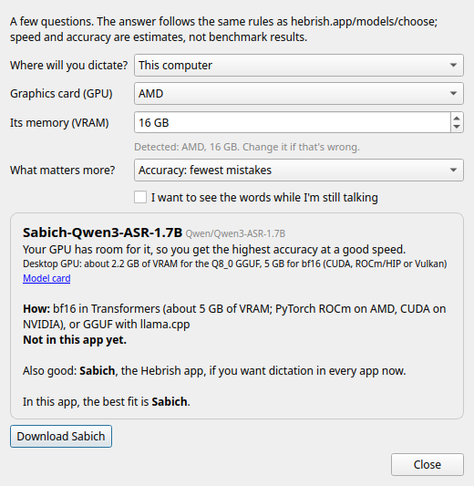

# Hebrish Dictation

**On-device dictation with NVIDIA Parakeet, for Android, Linux and Windows.** Made for the
English-Hebrew code-switching model; stock Parakeet is there too.

Everything runs **on your device**. The only network traffic is downloading the model you
pick (about 660 MB for the main models, once) and a periodic check for a newer version.

**Name:** the apps were first released as **Parlance** (0.1.0–0.1.2, 2026-10-19). Since
0.2.0 every identifier is Hebrish too: Android application ID `app.hebrish.dictation`, desktop
package and command `hebrish`, config and data under `hebrish`, default hotkey F14. Hebrish 0.2.0
is a fresh install. **Parlance continues as a separate general-purpose app**
([danielrosehill/Parlance-Dictation](https://github.com/danielrosehill/Parlance-Dictation)) that
keeps every `parlance` identifier and hotkey F13, so the two install side by side; an existing
0.1.x install becomes Parlance when Parlance 0.2.0 updates it. On first start the Hebrish desktop
app copies Parlance's settings (not its hotkey) and hardlinks its downloaded models.

**Website for the English-Hebrew code-switching model: [hebrish.app](https://hebrish.app)**: get the Hebrish keyboard for Android and the desktop apps, see the results, and find every model, dataset and demo in one place.

## Models

Models come in **lines**, named for what they are trained on, and each line has **versions on
different base models**, from the most accurate to the fastest. Both apps show them that way
(Android 0.7.0+, desktop 0.6.0+): pick a line, then a version, with a speed and accuracy rating
(1–5, estimates, the same as [hebrish.app/models/choose](https://hebrish.app/models/choose)), the download size, the hardware it needs and a one-line "who it's for", all in plain words ("Base model: Parakeet 0.6B v2 by NVIDIA");
formats, runtimes and repo ids are under each model's **Technical details**. The
desktop app also has **Help me choose**: device, graphics card and VRAM (detected where it can
be), and whether speed or accuracy matters more, and answers with the same rules as the website's chooser. The list is `shared/catalogue.json`.

| Line | Version | Base model | Status in the apps | For |
| --- | --- | --- | --- | --- |
| **Sabich** (everything: Hebrew words + tech vocabulary) | **Sabich** | Parakeet TDT 0.6B v2 | available, **recommended** | Start here: phone or any recent computer, no GPU. [Models](https://hebrish.app/models#sabich) |
| | Sabich-Qwen3-ASR-1.7B | Qwen3-ASR 1.7B | listed; not runnable in the apps yet | Most accurate. Desktop GPU: about 2.2 GB VRAM for the Q8_0 GGUF via llama.cpp, 5 GB for bf16 |
| | Sabich-Canary-Qwen-2.5B | Canary-Qwen 2.5B | listed; not runnable in the apps yet | Best on plain English, behind Qwen3-ASR on Hebrew words. Desktop GPU, about 6 GB VRAM (NeMo) |
| | Sabich-Parakeet-110M | Parakeet TDT-CTC 110M | available | Older phones, wearables: a fifth of the size (137 MB), faster, more mistakes |
| | Sabich-asr4all-M / -S | FUTO asr4all 56M / 28M | listed; not runnable in the apps yet | Tiny, for wearables; writes numbers as words |
| **Jachnun** (code-switching only) | **Jachnun** | Parakeet TDT 0.6B v2 | available | English + Hebrew vocabulary (*teudat zehut*, *arnona*, *bituach leumi*), in Latin letters. Recommended until 2026-10-21. [Models](https://hebrish.app/models#parakeet) |
| **Shakshuka** (streaming) | **Shakshuka** | Nemotron speech streaming 0.6B | desktop 0.7.0+ (streams while you talk); not on Android yet | Live text while you talk |
| **Parakeet (stock)** | | Parakeet TDT 0.6B v2 | available | Standard English, without the Hebrew words. NVIDIA's release, unchanged |

Everything the apps can run today is a sherpa-onnx int8 offline transducer. A version on an
engine the app doesn't have yet is shown greyed, with where it runs instead and its model card.

The fine-tunes are trained on **one speaker's voice**; recordings from more voices are welcome
([hebrish.app/contact?topic=samples](https://hebrish.app/contact?topic=samples)). Those are the only
models Hebrish ships. The other Parakeet fine-tunes (technical vocabulary, personal voice) are in
[Parlance](https://github.com/danielrosehill/Parlance-Dictation), the general-purpose twin of this
app; `desktop/tests/test_shared.py` fails if any other model appears in this catalogue.

On held-out recordings, the code-switching model (v3, the latest benchmarked version) cut
word error rate on code-switched English from 10.9% to 5.3%, and plain English got slightly
better, not worse. Training data, every version's results and the roadmap:
[English-Hebrew-Codeswitching-Parakeet-Finetune](https://github.com/Hebrish-ASR/English-Hebrew-Codeswitching-Parakeet-Finetune).

To help improve it, both apps have **Report a bug**, **Request a feature** and **Send
feedback**, which open an email to [feedback@hebrish.app](mailto:feedback@hebrish.app) with the
app and OS version filled in, and link to hebrish.app's contact form to
[suggest a word](https://hebrish.app/contact?topic=word),
[send voice samples](https://hebrish.app/contact?topic=samples) or
[get involved](https://hebrish.app/contact?topic=involved). On Android they are in the
**Hebrish** section at the bottom of the setup screen; on the desktop, in the tray's
**Hebrish** submenu, the About tab, and on each Hebrish model's card in the Models tab.

## Download

| Platform | What it is |
| --- | --- |
| **Android** | A voice keyboard (IME), the companion voice input for HeliBoard or any keyboard, plus an optional floating mic that dictates into any app without switching keyboards (0.3.0+). Android 9+, arm64. For a full keyboard with dictation built in, see [Hebrish Keyboard](https://github.com/Hebrish-ASR/Hebrish-Keyboard), a HeliBoard fork |
| **Ubuntu** | A tray app for Ubuntu 26.04 amd64 (.deb) |
| **Windows** | A portable tray app (.zip): unzip and run `Hebrish.exe` |

Which features each platform has, and which released builds are behind the code: [`docs/feature-parity.json`](docs/feature-parity.json).

Builds are on the [releases page](https://github.com/Hebrish-ASR/Hebrish-App/releases):
tags `android-v*` carry the APK, tags `desktop-v*` the .deb and the Windows zip. The Windows
build and the Android app have not yet been tried on real hardware.

## Desktop app (Linux and Windows)

- **Dictate**: press a hotkey anywhere (or Talk in the window), talk, and the text is pasted
  where your cursor is, inserted as you go every ~5 s and whenever you pause (Fast, Normal, Relaxed or a custom interval). An optional Stop and send key submits only once the last words are in. Output can also be the clipboard or the
  window's text box. The Dictate tab shows the microphone in use, a switcher, a level meter with
  a clip lamp, and a voice-detection toggle. Feedback is beeps, short spoken prompts, or off.
  Two hotkeys, any key or a foot pedal: a toggle key (tap to start, tap to stop; holding it
  is push-to-talk too, unless you turn that off) and an optional push-to-talk key. An optional
  floating overlay, like the Android floating mic, shows the take with Pause, Retake and Discard.
- **File**: drop or open an audio file. The transcript fills an editable text box piece by
  piece; save it as .txt or .md.
- **Models**: each line (Sabich, Jachnun, Shakshuka, stock Parakeet) with its versions under it,
  each with speed and accuracy dots, size, hardware, a one-line recommendation and its own
  Download, Use and Delete; **Help me choose** recommends one from your device, GPU and priority.
  Choose the folder the weights are stored in. History is optional (off by default).

Ubuntu: `sudo apt install ./hebrish_<version>-1_amd64.deb`, then
`sudo usermod -aG input $USER` for the hotkey, and log in again. It replaces Voice To
Hebrish and Parakeet-Type-Ubuntu, and keeps Voice To Hebrish's settings and downloaded
model. Details: [`desktop/README.md`](desktop/README.md).

## Android app

A voice keyboard (IME). Open the app, pick a model, and tap **Try it now** to test it in a
built-in notepad before setting anything up. Once it's set up, HeliBoard's mic key opens it,
you talk, and you're returned to HeliBoard with the text inserted. Details:
[`android/README.md`](android/README.md).

## Repository layout

| Path | What |
| --- | --- |
| `desktop/` | Linux + Windows app (Python, PySide6, sherpa-onnx). Only the hotkey and paste code differs per OS |
| `android/` | Android voice keyboard (Kotlin, sherpa-onnx built from source) |
| `shared/catalogue.json` | The model catalogue (schema 2: lines and variants) both apps bundle and re-fetch since Android 0.7.0 / desktop 0.6.0; a test fails if either app's copy drifts |
| `shared/models.json` | The schema-1 catalogue, kept for older builds; a test fails if it disagrees with `catalogue.json` |
| `shared/updates-android.json` | Android's in-app What's new list (Updates screen), baked from hebrish.app's changelog by `scripts/bake_updates.py`, Android entries only (by each entry's `data-platforms`, 2026-10-31); copied into the APK as `assets/updates.json` at build time. The desktop's list (Desktop and Site entries) is `desktop/hebrish/data/updates.json`, written by the same script |
| `shared/update-protocol.md` | How models are listed, downloaded and updated, and the quirks both apps work around |
| `planning/` | Public project tracking: feature requests, backlog (with ideas for future versions), decision log |
| `CLAUDE.md` | Agent instructions, public on purpose. The project's skills are in the public [`hebrish` marketplace](https://github.com/Hebrish-ASR/Hebrish-Claude-Plugins), plugin `hebrish-maintainers` |

Versions are `M.NNN` (three digits after the point): 1.000 (2026-10-24) was the first, for both
apps, and every GitHub release before it was deleted that day (the `*-v0.*` tags remain).
Before tagging, add the release's entry to hebrish.app's changelog: `scripts/release-tag.sh` runs
`scripts/bake_updates.py`, which bakes the changelog up to that day into the apps' What's new list
(one per app: `shared/updates-android.json` and `desktop/hebrish/data/updates.json`, the last 20 entries for that platform, offline) and commits it with the version.
Releases: tag `android-vM.NNN` builds the signed APK in CI. Tag `desktop-vM.NNN` builds the
Ubuntu 26.04 .deb in CI (an `ubuntu:26.04` container), installs and self-tests it, and attaches it
to the release. The default release is Android and the .deb (Daniel, 2026-10-31); the Windows zip
is built only on request: `gh workflow run desktop.yml -R Hebrish-ASR/Hebrish-App -f windows=true
-f tag=desktop-vM.NNN` attaches it to that release. Then overwrite the one stable file per platform on the Hebrish CDN
(`https://cdn.hebrish.app/apps/{android,ubuntu,windows}/`: `Hebrish-latest.apk`,
`hebrish-latest-amd64.deb`, `Hebrish-latest-windows-x64.zip`; since 2026-10-21, old versions
stay only on the GitHub releases) and rewrite `downloads/latest.json` (the `r2-upload` skill in
`voice-model-training`). hebrish.app needs no edit: its buttons link
`hebrish.app/get/<platform>`, which redirects to the file `latest.json` names. The F-Droid
repository (Hebrish-ASR/Hebrish-FDroid) builds from the GitHub releases, not the CDN; it checks
hourly, and every Android release also runs its `publish.yml` and checks the index lists the new version. Adding a model needs no release:
see `shared/update-protocol.md`.

## History

Hebrish Dictation (first released as Parlance, 2026-10-19) is the successor to all of the author's earlier Parakeet dictation
apps, and the only one maintained:

- **Voice To Hebrish** (2026-10-18), the Android + desktop monorepo this repo was copied
  from, history included. It ran only the code-switching model.
- Before that, *English-Hebrew-Codeswitching-Voice-Keyboard-Android* ("Codeswitch Voice")
  and *English-Hebrew-Codeswitching-Dictation-Linux* ("Codeswitch Dictation").
- **Parakeet-Type-Ubuntu** (`parakeet-dictation`), a KDE-only app with stock and
  code-switching profiles.

## License

Apps: MIT. Fine-tuned models: CC-BY-4.0. Stock Parakeet: CC-BY-4.0 (NVIDIA).
