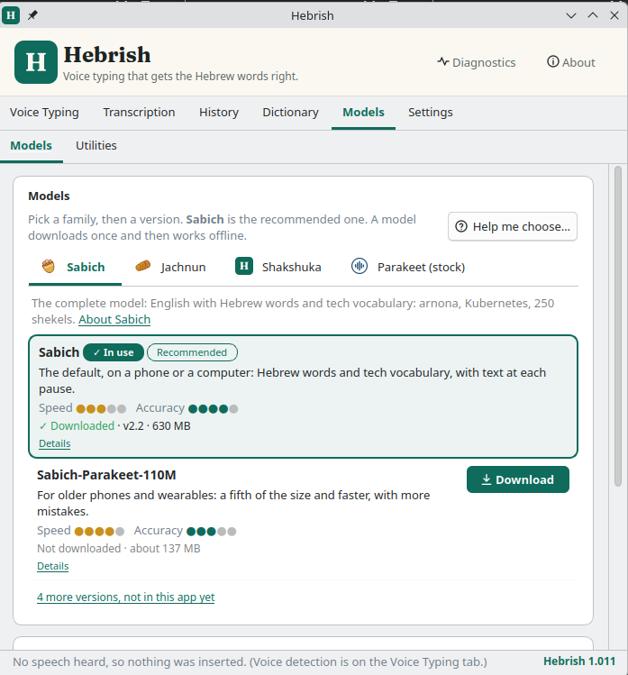

# Parlance

**On-device dictation with NVIDIA Parakeet, for Android, Linux and Windows.** Pick the model
that suits how you talk: stock Parakeet, or a fine-tune of it.

Everything runs **on your device**. The only network traffic is downloading the model you
pick (~630 MB, once) and a periodic check for a newer version.

**Website for the English-Hebrew code-switching model: [hebrish.app](https://hebrish.app)**: get the Hebrish keyboard for Android and the desktop apps, see the results, and find every model, dataset and demo in one place.

## Models

Every model is [Parakeet TDT 0.6B v2](https://huggingface.co/nvidia/parakeet-tdt-0.6b-v2),
run with sherpa-onnx (int8).

| Model | Status | For |
| --- | --- | --- |
| **Parakeet (stock)** | available | General English, any speaker. NVIDIA's release, unchanged |
| **English-Hebrew code-switching** | available | English with Hebrew words in it (*teudat zehut*, *arnona*, *bituach leumi*), written in Latin letters. [Model card](https://huggingface.co/danielrosehill/Parakeet-TDT-0.6B-v2-English-Hebrew-Codeswitching) · website: [hebrish.app](https://hebrish.app) |
| **Technical vocabulary** | coming soon | Software, AI and infrastructure terms |
| **Personal (general)** | coming soon | General English in the author's voice (Irish-accented), for slightly higher everyday accuracy |

The fine-tunes are trained on **one speaker's voice**, so they work best for voices like that
one; stock Parakeet is the better choice for anyone else. Models marked *coming soon* appear
in the apps by themselves once published: both apps re-read the catalogue
([`shared/models.json`](shared/models.json)) from this repo when they check for updates.

On held-out recordings, the code-switching model (v3, the latest benchmarked version) cut
word error rate on code-switched English from 10.9% to 5.3%, and plain English got slightly
better, not worse. Training data, every version's results and the roadmap:
[English-Hebrew-Codeswitching-Parakeet-Finetune](https://github.com/Hebrish-ASR/English-Hebrew-Codeswitching-Parakeet-Finetune).

To help improve it, both apps have **Report a bug**, **Request a feature** and **Send
feedback**, which open an email to [feedback@hebrish.app](mailto:feedback@hebrish.app) with the
app and OS version filled in, and link to hebrish.app's contact form to
[suggest a word](https://hebrish.app/contact?topic=word),
[send voice samples](https://hebrish.app/contact?topic=samples) or
[get involved](https://hebrish.app/contact?topic=involved). On Android they are in the
**Hebrish** section at the bottom of the setup screen; on the desktop, in the tray's
**Hebrish** submenu, the About tab, and under the code-switching model on the Model tab.

## Download

| Platform | What it is |
| --- | --- |
| **Android** | A voice keyboard (IME), the companion voice input for HeliBoard. Android 9+, arm64 |
| **Ubuntu** | A tray app for Ubuntu 26.04 amd64 (.deb) |
| **Windows** | A portable tray app (.zip): unzip and run `Parlance.exe` |

Builds are on the [releases page](https://github.com/Hebrish-ASR/Parlance-Dictation/releases):
tags `android-v*` carry the APK, tags `desktop-v*` the .deb and the Windows zip. The Windows
build and the Android app have not yet been tried on real hardware.

## Desktop app (Linux and Windows)

- **Dictate**: press a hotkey anywhere, talk, and the text is pasted where your cursor is.
  The hotkey can be any key or a foot pedal. Tap it to start and stop, or hold it while you
  talk.
- **Transcribe**: record with a level meter, a timer and pause, or open or drop an audio
  file. The transcript fills an editable text box piece by piece; save it as .txt or .md.
- **Model**: choose the model, download it, switch between downloaded ones, keep or delete
  old versions.

Ubuntu: `sudo apt install ./parlance_<version>-1_amd64.deb`, then
`sudo usermod -aG input $USER` for the hotkey, and log in again. It replaces Voice To
Hebrish and Parakeet-Type-Ubuntu, and keeps Voice To Hebrish's settings and downloaded
model. Details: [`desktop/README.md`](desktop/README.md).

## Android app

A voice keyboard (IME). Open the app, pick a model, and tap **Try it now** to test it in a
built-in notepad before setting anything up. Once it's set up, HeliBoard's mic key opens it,
you talk, and you're returned to HeliBoard with the text inserted. Details:
[`android/README.md`](android/README.md).

## Repository layout

| Path | What |
| --- | --- |
| `desktop/` | Linux + Windows app (Python, PySide6, sherpa-onnx). Only the hotkey and paste code differs per OS |
| `android/` | Android voice keyboard (Kotlin, sherpa-onnx AAR) |
| `shared/models.json` | The model catalogue both apps bundle and re-fetch; a test fails if either app's copy drifts |
| `shared/update-protocol.md` | How models are listed, downloaded and updated, and the quirks both apps work around |

Releases: tag `android-vX.Y.Z` builds the signed APK in CI. Tag `desktop-vX.Y.Z` builds the
Windows zip in CI; the Ubuntu .deb is built with `desktop/build-deb.sh` and added to the same
release. Adding a model needs no release: see `shared/update-protocol.md`.

## History

Parlance (2026-10-19) is the successor to all of the author's earlier Parakeet dictation
apps, and the only one maintained:

- **Voice To Hebrish** (2026-10-18), the Android + desktop monorepo this repo was copied
  from, history included. It ran only the code-switching model.
- Before that, *English-Hebrew-Codeswitching-Voice-Keyboard-Android* ("Codeswitch Voice")
  and *English-Hebrew-Codeswitching-Dictation-Linux* ("Codeswitch Dictation").
- **Parakeet-Type-Ubuntu** (`parakeet-dictation`), a KDE-only app with stock and
  code-switching profiles.

## License

Apps: MIT. Fine-tuned models: CC-BY-4.0. Stock Parakeet: CC-BY-4.0 (NVIDIA).
