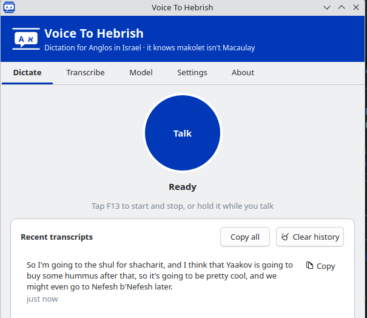

# Voice To Hebrish: desktop (Linux and Windows)

The desktop app of [Voice To Hebrish](../README.md): dictation for English speakers in
Israel, running the English-Hebrew Parakeet fine-tune on your CPU with sherpa-onnx.



## Two ways to work

**Dictate** (hotkey, anywhere):
- The hotkey can be any key on any keyboard, or a foot pedal. There are three modes:
  - *hybrid* (the default): a tap starts and a second tap stops; holding the key is push-to-talk.
  - *toggle*: tap to start, tap to stop.
  - *hold*: push-to-talk.
- The text is pasted at the cursor: the app puts it on the clipboard and sends Ctrl+V, so
  it works whatever keyboard layout is active, Hebrew included. Clipboard-only is an option.
- Recent transcripts are listed with Copy buttons, plus **Copy all** and **Clear history**.
- `voice-to-hebrish --toggle` starts or stops the running app, for a desktop shortcut.

**Transcribe** (long form):
- Pick the microphone, then record with a level meter, a timer and Pause/Resume. Recordings can run up to 3 hours.
- Or open an audio file, or drop one on the tab. With ffmpeg installed it reads any format; without it, WAV, FLAC, OGG and MP3.
- The transcript fills an editable text box piece by piece, about one paragraph per 30 s, split at a pause.
- New transcripts are added at the end of the text.
- Copy the text, save it as .txt or .md, or save the recording as WAV.

**Also included:**
- **Tray icon:** closing the window leaves the app in the tray. Middle-click the tray icon to start or stop dictation.
- **Model management:**
  - It downloads the model (~660 MB) on first run and checks its SHA-256.
  - It checks for new fine-tunes on a schedule, and installs them automatically or after you confirm.
  - It can keep previous versions so you can switch back.
- **About tab:** what the model is, how it was trained, and its benchmark numbers.

## Install

**Ubuntu 26.04** (amd64): download the .deb from the
[releases](https://github.com/danielrosehill/Voice-To-Hebrish/releases), then:

```bash
sudo apt install ./voice-to-hebrish_*_amd64.deb
sudo usermod -aG input $USER     # for the hotkey; log in again afterwards
```

The .deb bundles sherpa-onnx (Ubuntu doesn't ship it) and is pinned to Ubuntu 26.04's
python3 (3.14). It replaces `codeswitch-dictation` (this app's old name) and
`parakeet-dictation` (Parakeet-Type-Ubuntu), so only one dictation app is installed. On
other Ubuntu releases, run `./install.sh` (a per-user venv; needs uv) or rebuild with
`./build-deb.sh`.

**Windows 10/11** (x64): download the `-windows-x64.zip` from the releases, unzip it, and
run `VoiceToHebrish.exe`. There is no installer and no admin rights are needed. Turn on
*Start at login* under Settings if you want it in the tray at every login. Windows
SmartScreen may warn you because the build is unsigned.

## Files

| | Linux | Windows |
| --- | --- | --- |
| Settings | `~/.config/voice-to-hebrish/config.json` | `%APPDATA%\VoiceToHebrish\config.json` |
| Models, history, state | `~/.local/share/voice-to-hebrish/` | `%LOCALAPPDATA%\VoiceToHebrish\` |
| Log | stderr | `%LOCALAPPDATA%\VoiceToHebrish\voice-to-hebrish.log` |

`config.json` keys and defaults: `DEFAULTS` in [`voice_to_hebrish/config.py`](voice_to_hebrish/config.py).
Model CLI: `voice-to-hebrish-model status|check|download [--replace]`.

## Development

```bash
# Linux: the distro python, for apt's PySide6 and evdev
uv venv --python /usr/bin/python3 --system-site-packages .venv && uv pip install -e . pytest
.venv/bin/python -m pytest tests
.venv/bin/voice-to-hebrish
```

Windows: `pip install -e ".[windows]"`. The CI build is `.github/workflows/desktop.yml`.
Internals and measured findings: [`docs/maintaining.md`](docs/maintaining.md).
