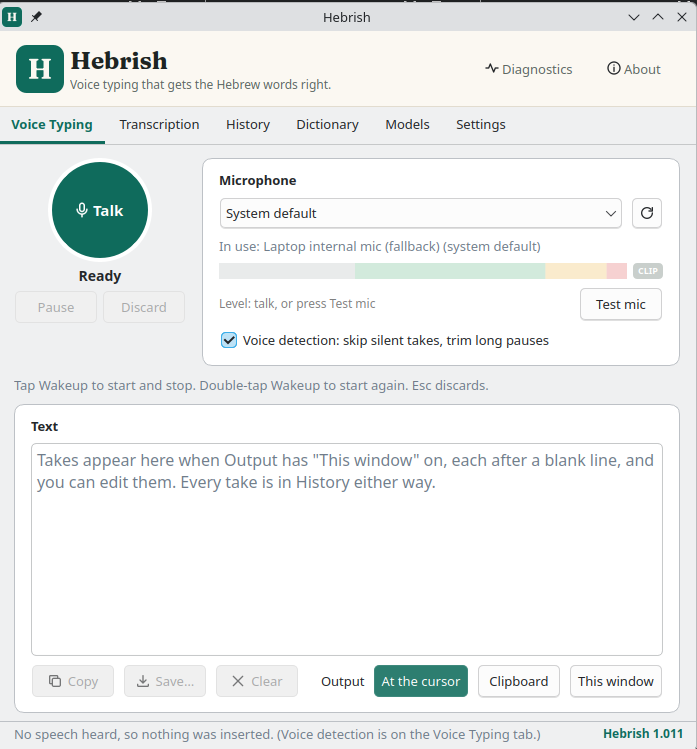

# Hebrish: desktop (Linux and Windows)

The desktop app of [Hebrish](../README.md): on-device dictation with NVIDIA Parakeet,
stock or the English-Hebrew code-switching fine-tune, running on your CPU with sherpa-onnx.

**Website for the English-Hebrew code-switching model: [hebrish.app](https://hebrish.app)**: get the Hebrish keyboard for Android and the desktop apps, see the results, and find every model, dataset and demo in one place.



## Two ways to work

**Dictate** (hotkey anywhere, or the Talk button on the Dictate tab):
- Two hotkeys, each any key on any keyboard or a foot pedal, and each optional (Settings →
  Dictation):
  - **Toggle key** (default F14): tap to start, tap again to stop. With *Holding it is
    push-to-talk too* (on by default) a long press works as push-to-talk instead.
  - **Push-to-talk key** (not set by default): hold it while you talk, release to stop.
  0.2.x settings carry over: *hold* mode becomes the push-to-talk key, *toggle* mode turns
  the hold option off.
- **Action keys** (optional, Settings → Action keys), for a macropad or foot pedals: one key
  each for **Start** (also resumes a paused take), **Stop**, **Pause/Resume**, **Retake** and
  **Discard**. A key can hold one job only; assigning it elsewhere moves it.
- **Stop and send** (0.7.0, optional action key): stops, waits for the last words to be pasted,
  then presses the **Send key** (`enter` by default; `ctrl+enter` or `shift+enter` where Enter
  makes a new line). For chat boxes and Claude Code, where an Enter pressed while the last piece
  is still being transcribed would submit without it. Paste output only.
- **Insert as you go** (Settings → Speed, on by default since 0.5.0): presets *Fast* (~5 s),
  *Normal* (~7 s, the default since 0.7.0; was ~10 s), *Relaxed* (~10 s), *Off*, or *Custom*
  (3–60 s). The take is decoded while you are still talking and the text is inserted at a pause, so a
  long take on a CPU-only computer shows up as you go and only the last few seconds are left when you stop. Text
  already inserted stays if you then Discard or Retake. *CPU threads* defaults to Auto
  (physical cores, at most 8).
- **Sounds** (Settings → Sounds): *Beeps* (start and stop), *Voice* (short spoken prompts:
  "Recording", "Paused", "Resumed", "Transcribing", "Discarded", and "Copied" when the output is
  the clipboard; nothing when the text arrives) or *Off*; one volume, and quiet hours. Since 0.7.0
  the voice is **Herman**, **Corn** or **Hilbert** (the My Weird Prompts podcast characters), and
  the microphone ignores a prompt while it plays, so it never ends up in the transcript.
- **Voice detection** (Dictate tab, on by default): a take with no speech is not decoded (no
  stray "Yeah."), and silences longer than 1.5 s are shortened before decoding.
- Settings apply as you change them; a short *Settings saved* toast confirms it.
- **Floating overlay** (optional, Settings → Floating overlay, or the tray's *Show overlay*):
  a small bar over every app, like the Android floating mic. While you dictate, the mic turns
  red (click it to stop) and the bar shows a timer, a level meter, **Pause/Resume**, **Retake**
  and **Discard**, then *Transcribing…* and *Inserted*. Show it *while dictating* or *always*
  (an idle mic button that starts a take, with its own opacity). Drag it anywhere; it opens
  towards the middle of the screen and never takes the keyboard focus.
- **Output** (Dictate tab): *Paste at the cursor* (the default: the app puts the text on the
  clipboard and sends Ctrl+V, so it works whatever keyboard layout is active, Hebrew included),
  *Clipboard only*, or *This window's text box only*. Every take also lands in the Dictate tab's
  editable text box (Copy, Save, Clear).
- **Microphone** (Dictate tab): the mic in use (for *System default*, which device that is right
  now), a switcher with rescan, and a level meter: too quiet / good / loud zones, the peak, and a
  CLIP lamp. *Test mic* shows the level without recording.
- **Built-in keys:** Esc discards a take while dictating; double-tapping the toggle key starts
  again (Retake). Both can be turned off in Settings → Dictation.
- **Diagnostics tab:** inference speed on this computer (tokens per second, × real time, stop →
  text latency, averaged over the last decodes), CPU, threads, model and memory, a benchmark
  button, and Copy as JSON.
- **History** is optional (Settings → *Keep a history*, off by default since 0.5.0): when on, a
  History tab lists the last 50 transcripts, saved on this computer.
- `hebrish --toggle` starts or stops the running app, for a desktop shortcut.

**File** (an audio file):
- Drop a file on the drop zone (half the tab) or click it to choose one. With ffmpeg installed it reads any format; without it, WAV, FLAC, OGG and MP3.
- The transcript fills an editable text box piece by piece, about one paragraph per 30 s, split at a pause.
- New transcripts are added at the end of the text. Copy it, or save it as .txt or .md.
- Long recordings: dictate with the Talk button (a take can run an hour), or record elsewhere and drop the file here.

**Also included:**
- **Start-up screen** while the model loads (not when started in the tray at login).
- **Tray icon:** closing the window leaves the app in the tray. Middle-click the tray icon to start or stop dictation.
- **Start at login** (Settings → System, or the tray menu): starts Hebrish in the tray when you log in, on Ubuntu (an XDG autostart entry) and Windows (the per-user Run key). It follows the app if you move it, for example a Windows zip unzipped to a new folder.
- **Models tab:** one card per model, with its icon: Sabich (the complete model: code-switching
  plus tech vocabulary; recommended), Jachnun (code-switching only) and stock Parakeet. The model
  you dictate with is outlined in green with an **In use** badge; the others have their own
  **Download**, **Switch to …** and **Delete**, so you can download a model without switching to it.
  The other fine-tunes are in Parlance (danielrosehill/Parlance-Dictation). A new version
  appears by itself (the app re-reads the catalogue from this repo).
  - Each model (~660 MB) downloads once, on request, with its SHA-256 checked.
  - **Where the models are stored** shows the folder (the default, or one you chose with
    *Change folder…*; the app offers to move the downloaded models there) and opens it.
  - It checks the selected model for new versions on a schedule, and installs them
    automatically (the default since 0.5.1) or after you confirm. A new version replaces the old one, which is deleted once the new one has verified, so each model is on disk once.
- **About tab:** versions, the main links, the models, and Jachnun's benchmarks and training data.
- **Hebrish links:** [hebrish.app](https://hebrish.app), the code-switching model's website,
  email to feedback@hebrish.app (report a bug, request a feature, send feedback; your mail
  client opens with the app and OS version filled in), and the site's contact form (suggest a
  word, send voice samples, get involved). In
  the tray's **Hebrish** submenu, on the About tab, and on each Hebrish model's card in the
  Models tab.

## Install

**Ubuntu 26.04** (amd64): download the .deb from the
[releases](https://github.com/Hebrish-ASR/Hebrish-App/releases), then:

```bash
sudo apt install ./hebrish_*_amd64.deb
sudo usermod -aG input $USER     # for the hotkey; log in again afterwards
```

The .deb bundles sherpa-onnx (Ubuntu doesn't ship it) and is pinned to Ubuntu 26.04's
python3 (3.14). It runs natively on Wayland (GNOME and KDE) and on X11; see
[`docs/maintaining.md`](docs/maintaining.md), "Wayland", for how each part works there. It replaces the predecessor apps `voice-to-hebrish`, `codeswitch-dictation`
and `parakeet-dictation` (Parakeet-Type-Ubuntu), so only one dictation app is installed, and
on first start it adopts Voice To Hebrish's settings and downloaded model. On
other Ubuntu releases, run `./install.sh` (a per-user venv; needs uv) or rebuild with
`./build-deb.sh`.

**Updates.** Hebrish checks for a new version at start and about once a day (Settings →
App updates; turn it off there). On Ubuntu, from 0.6.2 the .deb adds the Hebrish APT
repository, so *Update now* installs the new version after asking for your password, and
Software Updater picks it up too; with an older .deb you get a link to the new one. On Windows
you get a link to the new zip.

**Windows 10/11** (x64): download the `-windows-x64.zip` from the releases, unzip it, and
run `Hebrish.exe`. There is no installer and no admin rights are needed. Turn on
*Start at login* (Settings → System, or the tray menu) if you want it in the tray at every login. Windows
SmartScreen may warn you because the build is unsigned.

**Alongside Parlance.** Up to 0.1.2 this app was called Parlance internally (package, command
and folders `parlance`). From 0.2.0 Hebrish and [Parlance](https://github.com/danielrosehill/Parlance-Dictation)
are separate apps that can be installed together; an existing 0.1.x `parlance` install stays
Parlance and is upgraded by Parlance 0.2.0. On its first start Hebrish copies Parlance's
settings (except the hotkey) and history, and hardlinks its downloaded models (copies them if
hardlinking fails), so nothing is downloaded twice and Parlance is left untouched. Hebrish's
default hotkey is F14 because Parlance keeps F13: both apps read keys without grabbing them, so
a shared hotkey would start both.

## Files

| | Linux | Windows |
| --- | --- | --- |
| Settings | `~/.config/hebrish/config.json` | `%APPDATA%\Hebrish\config.json` |
| Models (default; Models tab → *Change folder…*), history, state | `~/.local/share/hebrish/` | `%LOCALAPPDATA%\Hebrish\` |
| Log | stderr | `%LOCALAPPDATA%\Hebrish\hebrish.log` |

`config.json` keys and defaults: `DEFAULTS` in [`hebrish/config.py`](hebrish/config.py).
Model CLI: `hebrish-model list`, `hebrish-model use <model>`,
`hebrish-model status|check|download [<model>] [--replace]`.

## Development

```bash
# Linux: the distro python, for apt's PySide6 and evdev
uv venv --python /usr/bin/python3 --system-site-packages .venv && uv pip install -e . pytest
.venv/bin/python -m pytest tests
.venv/bin/hebrish
```

Windows: `pip install -e ".[windows]"`. The CI build is `.github/workflows/desktop.yml`.
Internals and measured findings: [`docs/maintaining.md`](docs/maintaining.md).
